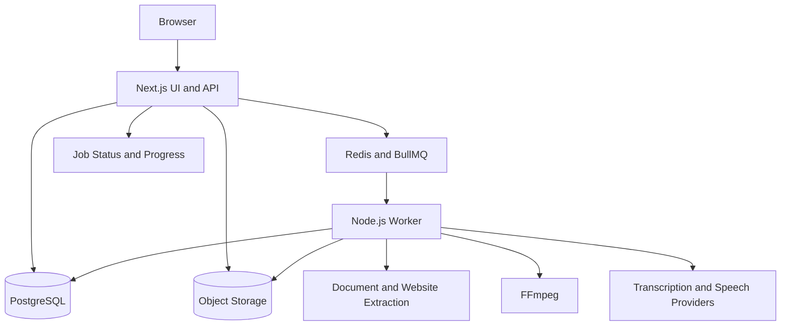

# Project Plan: Transcriber & Speaker

Build a JavaScript application that turns **audio, video, websites, chats, and documents into readable text and spoken audio**.

I recommend starting with a web application using **Next.js and Node.js**, then adding advanced transcription and voice features in phases.

## 1. Core Functionality

| Module | Features |
|---|---|
| Audio transcription | Upload audio, convert speech to text, detect language, and include timestamps |
| Video transcription | Upload video, extract audio, and generate transcripts and subtitles |
| Document reader | Extract text from PDF, DOCX, TXT, Markdown, HTML, and CSV |
| Website reader | Import a public URL, extract its main content, and read it aloud |
| Text and chat reader | Paste text or chat conversations and convert them to speech |
| Text-to-speech | Choose a voice, language, and playback speed; generate downloadable audio |
| Transcript editor | Correct text, search, and jump to matching audio timestamps |
| Library | Save files, transcripts, extracted documents, and generated audio |
| Export | Download TXT, DOCX, PDF, SRT, VTT, and supported audio formats |

**Important scope boundaries:**
- “Any document” should mean an expanding list of supported formats, not a promise to parse every file.
- Scanned PDFs and images require OCR.
- Legacy DOC files need a conversion service or separate conversion step.
- Importing chat from other platforms requires supported exports or authorized integrations.
- Website imports should not bypass authentication, paywalls, or access restrictions.

## 2. Main User Workflows

### Transcribe Audio or Video
1. Upload a supported file.
2. Select a language or use automatic detection.
3. Start transcription and see job progress.
4. Review the transcript alongside the media player.
5. Edit text and export a transcript or subtitles.

### Read Documents or Websites
1. Upload a document, paste text, or enter a public URL.
2. Review the extracted content.
3. Choose the voice, language, and speed.
4. Listen, pause, seek, or download generated speech.

### Work With Chats
1. Paste a conversation or upload a supported chat export.
2. Identify speakers and remove unwanted messages.
3. Read the conversation aloud.
4. Optionally assign different voices to participants.

## 3. Suggested Screens

- **Dashboard:** Recent projects, processing jobs, and usage.
- **New Project:** Upload media, upload documents, paste text/chat, or import a URL.
- **Workspace:** Source preview, editable text, media player, and voice controls.
- **Library:** Search, filter, rename, download, and delete projects.
- **Settings:** Account, default language, voice preferences, and retention settings.

The primary screen should be the working dashboard, not a marketing page.

## 4. JavaScript Technology Stack

| Layer | Recommendation |
|---|---|
| Frontend and API | Next.js with React, using JavaScript |
| Styling | Tailwind CSS and an accessible component library |
| Database | PostgreSQL |
| Database access | Prisma |
| Background jobs | BullMQ with Redis |
| File storage | S3-compatible object storage |
| Audio/video processing | FFmpeg |
| PDF extraction | PDF.js |
| DOCX extraction | Mammoth |
| Website extraction | Mozilla Readability with JSDOM |
| OCR | Tesseract.js initially, or a managed OCR service |
| Speech services | A transcription and text-to-speech provider behind replaceable adapters |
| Validation | Zod |
| Tests | Vitest and Playwright |
| Local infrastructure | Docker Compose |

**Architecture choice:** Keep the web app and API together initially, but run transcription, OCR, and audio generation in a separate Node.js worker. Long-running processing should not happen inside a normal web request.

For a low-cost prototype, browser speech synthesis can provide playback. Use server-generated speech when downloadable audio and consistent voices are required.

## 5. System Architecture



Use polling for job progress in the MVP. Add server-sent events later if needed.

## 6. JavaScript Project Structure

Proposed structure, using npm workspaces:

```text
transcriber-speaker/
├── apps/
│   ├── web/
│   │   ├── src/
│   │   │   ├── app/
│   │   │   │   ├── (auth)/
│   │   │   │   ├── dashboard/
│   │   │   │   ├── projects/[projectId]/
│   │   │   │   ├── library/
│   │   │   │   ├── settings/
│   │   │   │   └── api/
│   │   │   │       ├── projects/
│   │   │   │       ├── uploads/
│   │   │   │       ├── imports/
│   │   │   │       ├── jobs/
│   │   │   │       └── exports/
│   │   │   ├── components/
│   │   │   │   ├── ui/
│   │   │   │   ├── upload/
│   │   │   │   ├── editor/
│   │   │   │   └── player/
│   │   │   ├── hooks/
│   │   │   └── lib/
│   │   └── package.json
│   └── worker/
│       ├── src/
│       │   ├── index.js
│       │   ├── processors/
│       │   │   ├── transcription.js
│       │   │   ├── extraction.js
│       │   │   ├── speech.js
│       │   │   └── export.js
│       │   └── services/
│       │       ├── ffmpeg.js
│       │       └── ocr.js
│       └── package.json
├── packages/
│   ├── database/
│   │   ├── prisma/
│   │   │   └── schema.prisma
│   │   └── src/
│   ├── providers/
│   │   └── src/
│   │       ├── transcription/
│   │       └── speech/
│   └── shared/
│       └── src/
│           ├── validation/
│           ├── constants/
│           └── jobs/
├── tests/
│   ├── integration/
│   ├── e2e/
│   └── fixtures/
├── docs/
├── docker-compose.yml
├── .env.example
├── .gitignore
└── package.json
```

Keep API secrets, provider calls, and storage credentials on the server. Use JSDoc and JavaScript checking to improve maintainability without requiring TypeScript.

## 7. Database Design

| Entity | Purpose |
|---|---|
| User | Account and preferences |
| Project | Owner, title, source type, and processing state |
| Asset | Uploaded media, source files, and generated outputs |
| Document | Extracted text and editable content |
| TranscriptSegment | Text, start/end timestamps, and optional speaker |
| SpeechGeneration | Voice, settings, source text revision, and output asset |
| Job | Processing stage, progress, retry count, and errors |
| UsageRecord | Audio minutes, speech characters, OCR pages, and storage usage |

Store files in object storage, not directly in PostgreSQL. Link generated speech to a text revision so edits do not silently mismatch existing audio.

## 8. MVP and Later Features

**MVP**
- Authentication and private projects.
- MP3/WAV audio and MP4 video uploads.
- Transcription with timestamped segments.
- PDF, DOCX, and TXT extraction.
- Pasted text and public website imports.
- Voice selection, playback, and downloadable speech.
- Transcript editing and TXT/SRT/VTT exports.
- Background progress, useful errors, and deletion.

**Phase 2**
- OCR for scanned documents.
- Speaker identification and editable speaker names.
- Structured chat imports and per-speaker voices.
- DOCX/PDF exports, bulk uploads, and additional formats.
- Translation and summaries, with originals preserved.

**Phase 3**
- Live microphone transcription.
- Shared projects and team permissions.
- Billing, quotas, and external API access.
- Optional consent-based custom voices, subject to provider safeguards.

## 9. Implementation Roadmap

For one experienced full-time developer, a hosted-service MVP is roughly **8–12 weeks**, depending on quality requirements and provider integrations.

| Stage | Deliverable |
|---|---|
| 1. Foundation | Repository, database, authentication, storage, and dashboard |
| 2. Processing pipeline | Upload validation, queue, worker, progress, retries, and cleanup |
| 3. Transcription | FFmpeg integration, provider adapter, timestamp editor, subtitle export |
| 4. Content extraction | PDF/DOCX/TXT, pasted content, and secure website imports |
| 5. Speech | Voice selection, chunked generation, playback, and download |
| 6. Release readiness | Automated tests, accessibility, security, quotas, and deployment |

## 10. Security and Quality Requirements

- Validate file signatures, sizes, durations, and supported formats.
- Isolate file processing and enforce CPU, memory, and execution limits.
- Protect URL imports against SSRF, including redirects and private-network addresses.
- Check project ownership on every API call and use expiring file links.
- Sanitize imported HTML and avoid logging private document content.
- Explain when content is sent to external AI providers and provide deletion controls.
- Add retries without duplicate outputs or unnecessary duplicate provider charges.
- Test extraction fixtures, timestamp playback, export correctness, and failed jobs.
- Track processing time, provider cost, failure rates, and storage usage.

**Recommended starting point:** Build one complete workflow first: **upload audio → transcribe → edit → export**. Then reuse that processing foundation for documents, websites, chats, and speech generation.